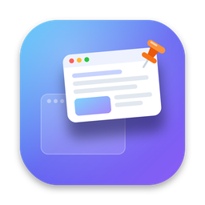
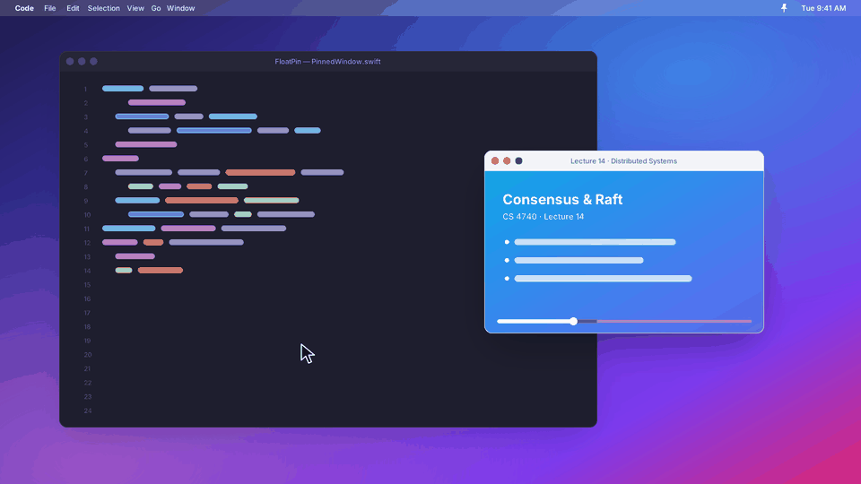
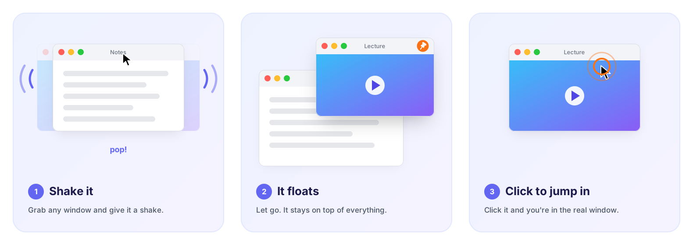

<div align="center">



# FloatPin

**Shake any window to keep it floating on top. Click it to jump back in.**

A tiny, free, open-source menu bar app for macOS. No account, no telemetry, no subscription.

[Download](https://github.com/Tron16/FloatPin/releases/latest/download/FloatPin.dmg) · [How it works](#how-it-works) · [Build it yourself](#build-it-yourself) · [Changelog](CHANGELOG.md) · [Contributing](CONTRIBUTING.md)

[](https://github.com/Tron16/FloatPin/releases/latest)
[](https://github.com/Tron16/FloatPin/releases)
[](https://github.com/Tron16/FloatPin/actions/workflows/build.yml)

[](LICENSE)

<br>



</div>

## Why

You're following a lecture, a tutorial, or a dashboard while you work in something else, and macOS keeps burying it. FloatPin fixes that with one gesture: grab the window, give it a shake, and it stays on top of everything until you shake it again.

The pinned window doesn't turn into a picture-in-picture box or jump to a corner. It stays exactly where you left it, at the same size, so it still feels like the same window.

<div align="center">

</div>

## What it does

- **Shake to pin.** Drag any window by its title bar and shake it. You hear a pop; let go and it's pinned right where you dropped it.
- **Feels like one window.** While you're in that window, you're using the real thing. Click anywhere else, even another window of the same app (like a second Chrome window), and it floats above everything.
- **Move and resize it** while it's floating. The real window follows along underneath, so nothing gets left behind.
- **Click to jump in.** Clicking a pinned window brings you straight into the real one, and your click goes through.
- **Shake again to unpin**, or click the little orange pin badge that shows up on hover.
- **⌃⌥P** pins or unpins the front window, and the menu bar lists every open window if you'd rather pick one.
- **Settings** for shake sensitivity, click-through, border, frame rate, sounds, and launch at login.

## Install

1. [Download FloatPin.dmg](https://github.com/Tron16/FloatPin/releases/latest/download/FloatPin.dmg) from the latest release.
2. Open it and drag **FloatPin** into **Applications**.
3. Open FloatPin. The first time, macOS will say it can't verify the developer, because FloatPin isn't notarized yet. Go to **System Settings → Privacy & Security**, scroll down, and click **Open Anyway**.
4. The setup window asks for two permissions. Click **Grant** on each and flip the switch in System Settings; the checkmarks update on their own.

Prefer the terminal? After dragging it into Applications:

```bash
xattr -dr com.apple.quarantine /Applications/FloatPin.app && open /Applications/FloatPin.app
```

## Private by default

FloatPin never touches the network. There's no analytics, no account, and nothing is saved to disk. It asks for two permissions, and only uses them for this:

| Permission | Why |
|---|---|
| **Screen Recording** | To show a live view of the window you pinned. Frames stay in memory and are thrown away immediately. |
| **Accessibility** | To keep the real window lined up under its pin and bring it forward when you click. |

## How it works

macOS doesn't let one app float another app's window. So FloatPin streams the window you pinned with ScreenCaptureKit into its own floating panel, and uses the Accessibility API to keep the real window glued directly underneath it.

Only one of the two is ever visible: the pin while you're in other apps, and the real window while you're in that app. That's the whole trick, and it's why a pinned window feels like the same window instead of a copy.

| File | What it does |
|---|---|
| [`Shake.swift`](Sources/Shake.swift) | Global mouse monitor and shake detection (counts direction reversals) |
| [`PinnedWindow.swift`](Sources/PinnedWindow.swift) | The floating panel, keeping the real window glued under it, the click hand-off, `PinManager` |
| [`WindowList.swift`](Sources/WindowList.swift) | Finds windows with `CGWindowListCopyWindowInfo`, moves and raises them with Accessibility |
| [`Permissions.swift`](Sources/Permissions.swift) | Permission checks, prompts, and deep links into System Settings |
| [`Views.swift`](Sources/Views.swift) | SwiftUI setup and settings screens |
| [`HotKey.swift`](Sources/HotKey.swift) | Global ⌃⌥P shortcut |
| [`AppDelegate.swift`](Sources/AppDelegate.swift) | Menu bar menu and wiring |

## Build it yourself

You need macOS 14 or newer and the Xcode command line tools (`xcode-select --install`). No Xcode project, no dependencies.

```bash
git clone https://github.com/Tron16/FloatPin.git
cd FloatPin
./build.sh install   # build, copy to /Applications, launch
./build.sh dmg       # build FloatPin.dmg
```

Local builds are ad-hoc signed, so macOS treats every rebuild as a new app and forgets its permissions. Either reset them after rebuilding:

```bash
tccutil reset Accessibility com.ashish.FloatPin && tccutil reset ScreenCapture com.ashish.FloatPin
```

or sign with your own certificate so they stick: `SIGN_IDENTITY="Apple Development: you@example.com (XXXX)" ./build.sh install`.

## When something misbehaves

- **Permissions look on but nothing happens:** remove FloatPin from both lists in System Settings, add it back, and relaunch (or use the `tccutil` command above).
- **Screen Recording stays unchecked after granting it:** click **Relaunch** in the setup window. macOS often only applies it after a restart of the app.
- **macOS 15 asks about screen recording again:** that's a monthly macOS reminder for every app that uses it. Allow it.
- **Shaking doesn't trigger:** lower "Back-and-forth moves needed" or "Shake distance" in Settings.
- **A pinned window lands slightly off:** some apps limit their own minimum size or position. Resize the pin a little and it'll re-sync.

Still stuck? [Open an issue](https://github.com/Tron16/FloatPin/issues/new/choose) with your macOS version and what you were pinning.

## Contributing

Bug reports, ideas, and pull requests are all welcome. See [CONTRIBUTING.md](CONTRIBUTING.md) for how the code is laid out and how to send a change.

## License

FloatPin is released under the [MIT License](LICENSE).

<div align="center">
<sub>Made by <a href="https://github.com/Tron16">Ashish Nattami Subramanian</a>. If it saves you some alt-tabbing, a ⭐ helps other people find it.</sub>
</div>
